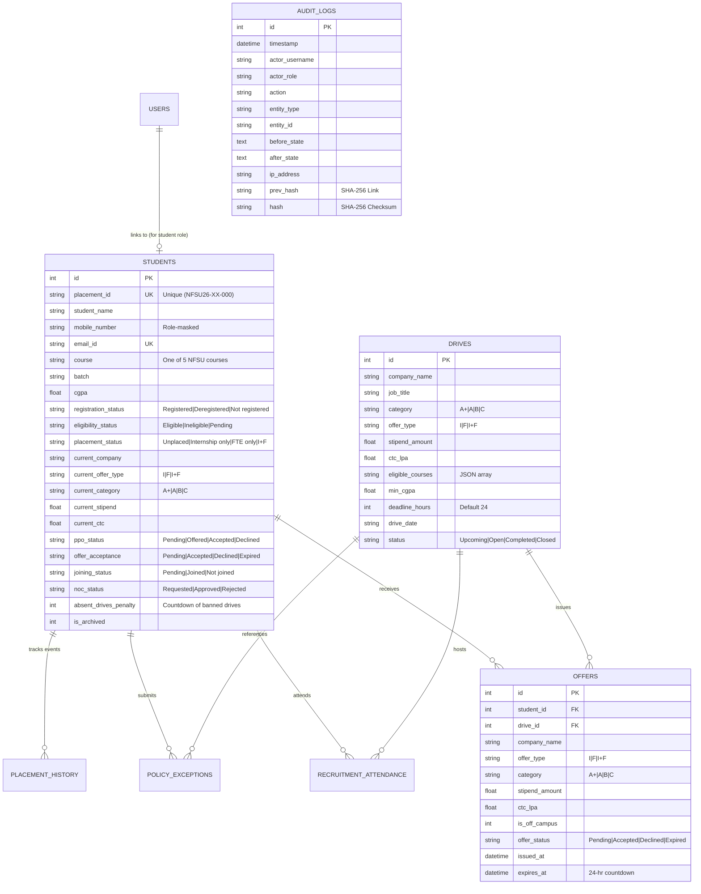

# NFSU Student Placement Management System (Session 2026–27)
## Technical Architecture, Policy Engine, and Security Documentation

---

### 1. Executive Summary & Problem Definition

The **Placement Cell of National Forensic Sciences University (NFSU)** requires a centralized, secure, and policy-driven web application to manage recruitment activity in accordance with the institutional **Student Placement Guidelines for the 2026–27 placement session**.

The system automates policy checks, eliminates manual data-entry discrepancies, flags policy conflicts, prevents unauthorized modifications, and produces verified placement statistics. Due to the sensitive nature of compensation figures and personal contact data, cybersecurity, privacy-by-design, and tamper-evident audit logging are core architectural foundations.

#### Programmes Covered:
1. **M.Tech. Computer Science** (`M.Tech. CS`)
2. **M.Tech. Artificial Intelligence and Data Science** (`M.Tech. AIDS`)
3. **B.Tech.–M.Tech. Computer Science and Engineering** (`B.Tech.-M.Tech. CS`)
4. **M.Sc. Computer Science** (`M.Sc. CS`)
5. **M.Sc. Digital Forensics and Information Security** (`M.Sc. DFIS`)

---

### 2. System Architecture & Technology Stack

The platform follows a layered, decoupled client-server architecture:

```
┌────────────────────────────────────────────────────────────────────────┐
│                        NFSU CLIENT APPLICATION                         │
│   Single-Page Web Application (HTML5, Vanilla CSS Design System, ES6)  │
│   • Executive Dashboard  • Student Database   • Recruitment Drives     │
│   • Offers & 24h Timers  • Policy Simulator   • Audit Log Inspector    │
│   • Security Test Lab    • Backup & Recovery  • Dynamic Role Switcher  │
└───────────────────────────────────┬────────────────────────────────────┘
                                    │ HTTPS / REST API + JWT Bearer
┌───────────────────────────────────▼────────────────────────────────────┐
│                        EXPRESS.JS API SERVER                           │
│  • Security Middleware (CSP, Anti-Clickjacking, X-XSS, CORS)           │
│  • Authentication & RBAC Authorization (Admin, Officer, Coord, etc.)   │
│  • IDOR & Privilege Escalation Defenses                                │
└──────────────┬────────────────────┬────────────────────┬───────────────┘
               │                    │                    │
┌──────────────▼─────┐ ┌────────────▼───────┐ ┌──────────▼──────────────┐
│ POLICY RULE ENGINE │ │ AUDIT LOGGER       │ │ STATISTICS ENGINE       │
│ • A+, A, B, C Tiers│ │ • SHA-256 Chaining │ │ • Accurate Median CTC   │
│ • B 1.5x Multiplier│ │ • Tamper Detection │ │ • Stipend vs CTC Split  │
│ • I, F, I+F Lock   │ │ • Forensic Proof   │ │ • Course Breakdown      │
│ • Absenteeism Ban  │ └────────────────────┘ └─────────────────────────┘
└──────────────┬─────┘
               │ Parameterized Queries (SQLite Prepared Statements)
┌──────────────▼─────────────────────────────────────────────────────────┐
│                    SQLITE EMBEDDED RELATIONAL STORE                    │
│   students • users • drives • offers • attendance • audit_logs • ...   │
└────────────────────────────────────────────────────────────────────────┘
```

#### Technology Stack:
- **Runtime**: Node.js v22 (LTS)
- **Web Framework**: Express.js with hardening headers (Content-Security-Policy, X-Frame-Options, X-Content-Type-Options)
- **Database**: SQLite with parameterized prepared statements (`node:sqlite` DatabaseSync)
- **Authentication**: Signed JSON Web Tokens (JWT) + BCrypt password hashing + MFA simulation
- **Cryptographic Audit Log**: Continuous SHA-256 hash chaining (`prev_hash` + data payload = `current_hash`)
- **Encryption**: AES-256-CBC for exportable backups and restore testing
- **Frontend**: Clean Vanilla JavaScript (ES6 Modules), Native HTML5 semantic markup, Custom Cyber-Institutional CSS Design System (Outfit & JetBrains Mono typography, dark/light theme support, glassmorphism, glowing micro-animations)

---

### 3. Database Schema & Data Models

The database schema is partitioned into 8 normalized relational tables:



---

### 4. Policy Rule Engine (NFSU Guidelines 2026–27)

The rule engine (`services/policyEngine.js`) executes a multi-stage evaluation pipeline for every drive registration or offer event:

#### 4.1 Company Category & Switching Thresholds

| Category | CTC Threshold | Policy Mandate | Switching Permitted? |
| :--- | :--- | :--- | :--- |
| **A+** | $\ge$ ₹16.0 LPA | Highest compensation tier | **Strictly Prohibited**. Selected students are completely out of the campus placement process. |
| **A** | ₹10.0 – 16.0 LPA | Core technical & defense tier | **Allowed ONLY to Category A+ companies** ($\ge$ ₹16 LPA). Lateral switches or switches to Category B/C are blocked. |
| **B** | ₹6.0 – 10.0 LPA | IT / Consultancy services tier | Allowed **ONLY where target package $\ge 1.5 \times$ current package**. |
| **C** | Below ₹6.0 LPA | Entry-level / research stipends | Eligible for **higher-category upgrades** (B, A, or A+). Lateral Category C to C switch is prohibited. |

#### 4.2 Offer-Type Restrictions
- **Internship only (I)**: Once selected, student *cannot* apply for another Internship-only role ($I \to I$ blocked), but *may* apply for FTE or $I+F$ roles.
- **FTE only (F)**: Once selected, student *cannot* apply for another FTE-only role ($F \to F$ blocked), but *may* apply for an internship role (subject to other guidelines).
- **Internship + PPO/FTE (I+F)**: Once selected, student is completely barred from participating in *any other* $I$, $F$, or $I+F$ drive across any other organization.

#### 4.3 Absenteeism & Attendance Policy
- Recruitment activity attendance is recorded across Pre-Placement Talks (PPT), Online Assessments, Technical Interviews, and HR Interviews.
- **Unexcused Absenteeism Flag**: If a student is absent from a scheduled recruitment drive activity without prior authorized exemption, the system automatically triggers a **3-drive exclusion penalty** (`absent_drives_penalty = 3`).
- **Emergency Exception Workflow**: The student or coordinator may submit an emergency exception petition (medical/institutional emergency). Upon review and approval by the Placement Administrator, the penalty counter is reset to `0`, and an audit trail entry is recorded.

#### 4.4 Offer Acceptance Deadline (24-Hour Timer)
- Under institutional guidelines, an issued offer must be accepted or declined within **24 hours** (or the company's stated deadline if shorter).
- The platform runs a real-time countdown timer. If the deadline expires without action, the offer status automatically changes to `Expired` and the candidate cannot accept without placement cell intervention.

---

### 5. Cybersecurity and Privacy Architecture

As a system built for National Forensic Sciences University, security controls are implemented at each layer:

1. **Authentication & Session Security**:
   - Passwords hashed with standard **BCrypt** with salt work factor of 10.
   - JWT sessions signed with HMAC-SHA256 and timed expiration.
   - Multi-Factor Authentication (MFA) simulation with 6-digit TOTP validation codes.

2. **Role-Based Access Control (RBAC)**:
   - **Placement Administrator**: Full database access, policy rule parameter configuration, audit chain inspection, emergency exception approval, backup generation.
   - **Placement Officer**: Student record maintenance, drive scheduling, attendance logging, offer issuance, audited CSV export.
   - **Course Coordinator**: View-only access scoped strictly to students enrolled in their assigned programme (e.g. M.Sc. DFIS or M.Tech. CS). Cannot view or edit compensation policies.
   - **Recruiter**: Drives management, viewing eligible applicant names (with contact numbers masked). Cannot inspect competitor CTC packages.
   - **Student**: View own placement status, explore eligible upcoming drives, review offers, accept/decline offers, submit NOC requests.

3. **Protection against Insecure Direct Object References (IDOR)**:
   - Specific Security Challenge: *"A student must not be able to change their own placement status or package, bypass switching restrictions, or access another student's confidential information by manipulating requests."*
   - Defense: All student profile and offer endpoints verify that `req.user.role === 'student'` must match `req.user.studentId === req.params.id`. Any direct ID parameter tampering triggers an immediate `403 Forbidden` response and an automated `SECURITY_ALERT_IDOR_ATTEMPT` audit entry.

4. **Privilege Escalation Defense**:
   - `PUT /api/students/:id` blocks students from modifying student profiles. Furthermore, Course Coordinators cannot alter compensation values; only Placement Officers and Admins possess authorized write scopes.

5. **SQL Injection Defense**:
   - 100% of queries use SQLite parameterized statements (`db.prepare('... WHERE field = ?').run/get/all`). String interpolation is completely banned.

6. **Tamper-Evident SHA-256 Audit Trail**:
   - Every state transition generates a continuous SHA-256 cryptographic hash block:
     $$\text{Hash}_i = \text{SHA-256}\left(\text{Hash}_{i-1} \parallel \text{Timestamp} \parallel \text{Actor} \parallel \text{Action} \parallel \text{Entity} \parallel \text{Diff} \parallel \text{IP}\right)$$
   - Built-in verification algorithm verifies that $\text{Hash}_i$ accurately chains to $\text{Hash}_{i-1}$ from the genesis block.
   - An interactive **Forensic Tamper Simulation** demonstration allows administrators to test out-of-band record tampering and watch the verification engine identify the exact modified record sequence.

7. **AES-256 Encrypted Backup and Tested Restore**:
   - Full system snapshots are encrypted via AES-256-CBC using PBKDF2/Scrypt key derivation.
   - Tested restoration route decrypts, validates table schema integrity, and logs the restoration event.

---

### 6. Automated Verification & Test Suite Results (Deliverable 7)

The system includes an automated test harness (`/api/tests/run`) that evaluates all 13 critical functional and security invariants:

| # | Test Suite | Test Case Name | Category | Result |
| :---: | :--- | :--- | :--- | :---: |
| 1 | Policy Engine | Category A+ ($\ge$ 16 LPA) No-Switching Lock | Category Rules | **PASS** |
| 2 | Policy Engine | Category A Switching to Lower/Equal Category Blocked | Category Rules | **PASS** |
| 3 | Policy Engine | Category A Switching to Category A+ Allowed | Category Rules | **PASS** |
| 4 | Policy Engine | Category B Multiplier Violation ($< 1.5\times$ CTC) | Switching Multiplier | **PASS** |
| 5 | Policy Engine | Category B Multiplier Satisfied ($\ge 1.5\times$ CTC) | Switching Multiplier | **PASS** |
| 6 | Policy Engine | Offer-Type: Internship-Only ($I \to I$) Re-application Blocked | Offer Types | **PASS** |
| 7 | Policy Engine | Offer-Type: Internship + PPO/FTE ($I+F$) Locked Out from All Drives | Offer Types | **PASS** |
| 8 | Policy Engine | Absenteeism 3-Drive Exclusion Enforcement | Disciplinary Checks | **PASS** |
| 9 | Policy Engine | Absenteeism Exclusion Override with Approved Exception | Disciplinary Checks | **PASS** |
| 10 | Cybersecurity | IDOR Defense: Cross-Student Profile & Salary Access Blocked | Access Control & IDOR | **PASS** |
| 11 | Cybersecurity | Privilege Escalation Defense: Self-Placement Tampering Blocked | Authorization & RBAC | **PASS** |
| 12 | Cybersecurity | SQL Injection Defense: Parameterized Query Verification | Input & Query Security | **PASS** |
| 13 | Cybersecurity | Audit Log Cryptographic Tamper-Evidence (SHA-256 Chain) | Audit Integrity | **PASS** |

**Overall Result: 13 / 13 Passed (100% Pass Rate). Status: `ALL_TESTS_PASSED`.**

---

### 7. Statistical Calculations & Reporting Accuracy

Section 3.3 mandates: *"Reports must distinguish internship stipends from annual FTE CTC and must count unique placed students separately from the total number of offers received."*

- **Unique Placed Students**: Calculated strictly by distinct student entities holding an active offer. Total offers is recorded as total offer events across time.
- **Accurate Median Calculation**:
  $$\text{Median} = \begin{cases} X_{\left(\frac{n+1}{2}\right)} & \text{if } n \text{ is odd} \\ \frac{X_{\left(\frac{n}{2}\right)} + X_{\left(\frac{n}{2}+1\right)}}{2} & \text{if } n \text{ is even} \end{cases}$$
- **Separated Compensation Fields**: Annual FTE packages are measured exclusively in LPA (Lakhs Per Annum). Internship stipends are recorded separately as monthly INR values ($\text{₹}/\text{month}$), preventing synthetic inflation of salary averages.

---

### 8. System Limitations & Future Roadmap

1. **Email / SMS Dispatch**: The current prototype logs notification events and 24-hr countdown alerts to the database and audit trail. Future integrations can attach institutional SMTP / SMS gateway credentials.
2. **Biometric Attendance Integration**: Attendance is currently logged via web interface by placement officers; integration with RFID or facial recognition turnstiles at campus test centers can be attached via the existing `/api/drives/:id/record-attendance` endpoint.
3. **Multi-Campus Multi-Tenancy**: The current schema easily extends to multiple NFSU campuses (Gandhinagar, Delhi, Goa, Tripura, Bhopal, Pune, Dharwad) by adding a `campus_id` foreign key attribute.
